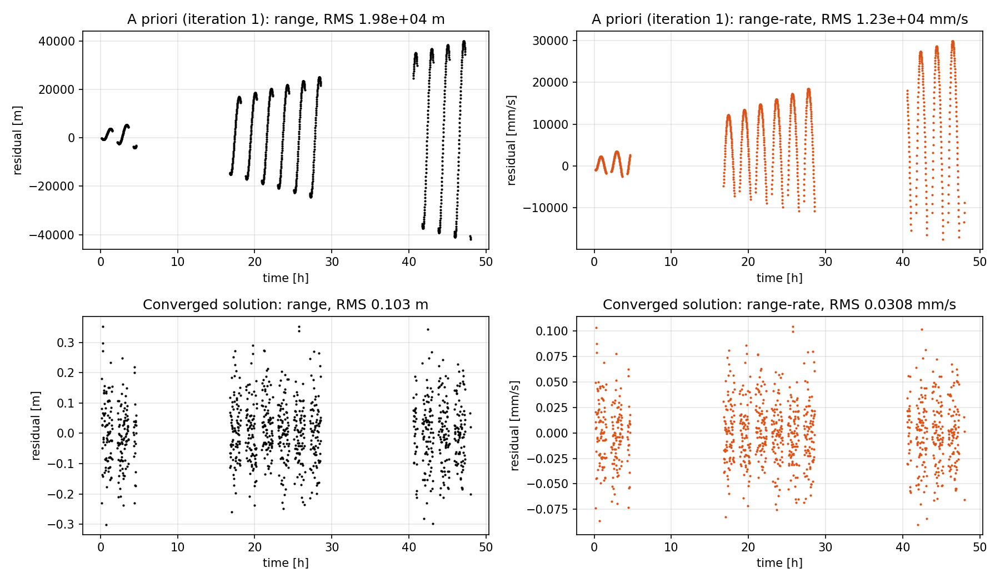
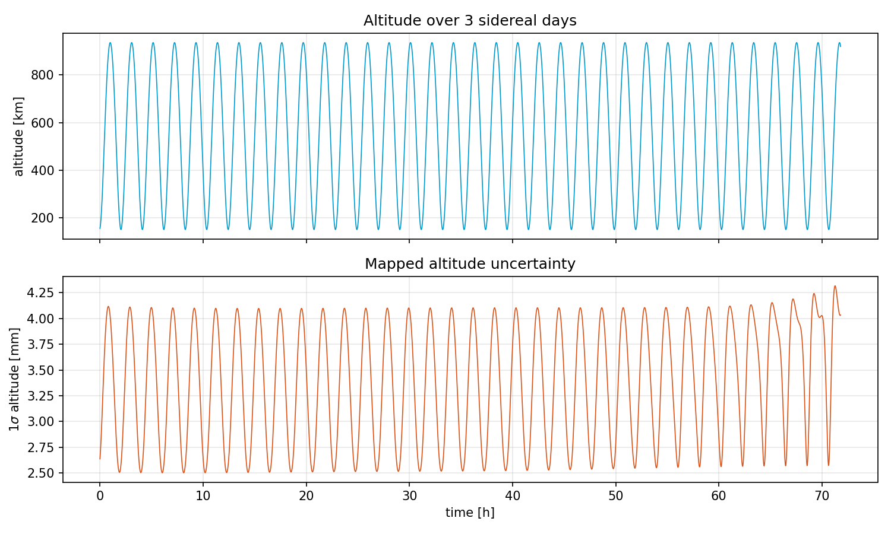

# Orbit Determination of a Mars Orbiter from Earth-Based Tracking

MATLAB implementation of a **batch weighted least-squares orbit determination** for a
spacecraft orbiting Mars, tracked in range and range-rate by a rotating ground station on the
Earth, 2.1 AU away. The filter estimates the spacecraft state together with the gravitational
parameter of Mars and the atmospheric density, then maps the covariance forward in time.



## Highlights

- **Estimated parameters**: position, velocity, $GM_{\text{Mars}}$ and reference atmospheric density
  $\rho_0$, from 999 range and range-rate measurements spread over 48 h.
- **Dynamics**: Mars monopole gravity and exponential-atmosphere drag, with the State Transition
  Matrix propagated through an analytical Jacobian.
- **Convergence**: from a priori residuals of about 20 km (range) and 12 m/s (range-rate) to
  noise-level residuals in 4 iterations: range RMS 0.10 m, range-rate RMS 0.031 mm/s.
- **Formal accuracy at epoch** (1σ): about 7 mm in position, 6 µm/s in velocity,
  7·10⁻⁵ km³/s² on GM.
- **Covariance analysis**: information content of each observable, altitude uncertainty over
  3 sidereal days, observability of the drag coefficient.

## Problem setup

| Item | Value |
|------|-------|
| Geometry | 2D, orbit in the Earth equatorial plane, planets fixed, no light-time correction |
| Forces | Mars monopole + drag, $\rho = \rho_0\, e^{-(h - z_0)/H}$ with $z_0$ = 35 km, $H$ = 14.7 km |
| Observables | range (σ = 0.5 m) and range-rate (σ = 0.04 mm/s), 999 epochs |
| Estimated state | $[x,\ y,\ v_x,\ v_y,\ GM,\ \rho_0]$, plus $C_D$ in Task 4 |
| A priori | 300 m, 5 cm/s, 3 km³/s², ρ₀ = 0 ± 0.03, diagonal covariance |

The estimator iterates the normal equations with a priori information
(Tapley, Schutz & Born):

$$
\hat{x} = \left(H^T W H + \bar{P}_0^{-1}\right)^{-1}\left(H^T W y + \bar{P}_0^{-1}\bar{x}\right),
\qquad P = \left(H^T W H + \bar{P}_0^{-1}\right)^{-1}
$$

where $H = \tilde{H}\,\Phi(t_i, t_0)$ maps the epoch state to the observations through the STM.

## Results

**Task 1 – Estimate at the reference epoch**

| Parameter | Estimate | Correction from a priori | 1σ |
|-----------|----------|--------------------------|----|
| x [km] | 2505.9118 | −0.248 | 6.3·10⁻⁶ |
| y [km] | 2505.9118 | +0.622 | 7.1·10⁻⁶ |
| vx [km/s] | −2.535622 | +4.6·10⁻⁴ | 6.0·10⁻⁹ |
| vy [km/s] | 2.617076 | +4.6·10⁻⁵ | 5.8·10⁻⁹ |
| GM [km³/s²] | 42828.000 | −2.000 | 7.0·10⁻⁵ |
| ρ₀ | 1.053·10⁻³ | +1.053·10⁻³ | 7.9·10⁻⁵ |

The normalised chi-square of the post-fit residuals is 0.04 for range and 0.59 for range-rate:
the actual measurement noise is lower than the declared accuracy, in particular for range
(about 0.1 m against 0.5 m).

**Task 2 – Range vs range-rate.** Separate range-only and range-rate-only solutions show that
range-rate gives 7 to 13 times smaller formal uncertainties on every parameter. The conclusion
holds even when the empirical noise levels are used as weights (2 to 3.6 times).

**Task 3 – Covariance mapping.** Over 3 sidereal days the altitude varies between 150 and
936 km (eccentric orbit, 2.1 h period) and its 1σ between 2.5 and 4.3 mm, oscillating with the
orbit and slowly growing.



**Task 4 – Drag coefficient as solve-for parameter** (a priori 1 ± 0.5). $C_D$ keeps its a priori
uncertainty (σ ≈ 0.50) and is almost perfectly anti-correlated with $\rho_0$ (−0.99), which doubles
to 2.1·10⁻³. Their product matches Task 1 to 4 significant digits: the tracking data
constrain the ballistic term $\rho_0 C_D$, not the two parameters separately.

## Repository structure

```
├── orbit_determination.m          # main script: Tasks 1-4
├── functions/
│   ├── batch_least_squares.m        # iterative batch WLS with a priori
│   ├── mars_dynamics_stm.m          # equations of motion + STM (6 or 7 states)
│   ├── mars_dynamics_jacobian.m     # analytical Jacobian of the dynamics
│   ├── range_observables.m          # computed observables and their partials
│   ├── ground_station_state.m       # rotating ground station
│   └── plot_residuals.m
├── data/observables.txt           # [t (s), range (km), range-rate (km/s)]
└── figures/
```

## How to run

Requires MATLAB R2020a or later, no toolboxes. Run `orbit_determination.m`; the tables of the
four tasks are printed in the Command Window. Set `SAVE_FIGURES = true` to export the plots.

## References

- B. D. Tapley, B. E. Schutz, G. H. Born, *Statistical Orbit Determination*, Elsevier, 2004.

## Author

**Girolamo Castronovo**, MSc in Space and Astronautical Engineering, Sapienza University of Rome.
Developed for the *Space Mission and Systems* course, 2024.
[LinkedIn](https://www.linkedin.com/in/girolamo-castronovo-286387269/)
